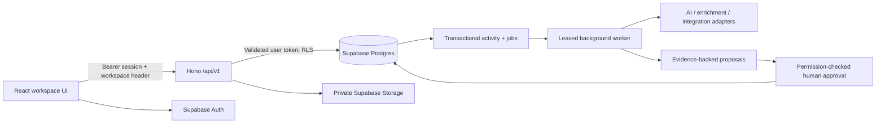
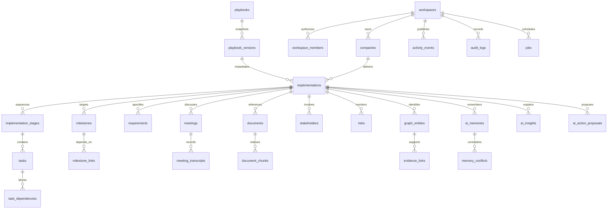

# AI Implementation OS — architecture v1

Status: implementation blueprint. This is a new product; Nexus code, identities, databases and deployments are not migration targets. The authoritative visual reference is the supplied **AI Implementation OS Design System Board**.

## 1. System architecture



The UI renders API results, not scoring or permission decisions. Authentication is Supabase Auth; authorization is a live active membership lookup plus PostgreSQL RLS. Production request clients NEVER use a service-role key. Background workers are separately privileged and narrowly scoped. External connectors are unavailable until a real provider is configured.

## 2. Entity relationship diagram



All tenant records have a workspace_id. Implementation children use composite foreign keys `(workspace_id, implementation_id)`; stage links include implementation_id as well. A guessed UUID or an incorrectly selected workspace must never connect different tenants or implementations. Foreign-key indexes accompany these constraints.

## 3. Database schema contract

Common columns: UUID `id`, random text `workspace_id`, `created_at`, `updated_at` where mutable. Implementation-scoped tables additionally have `implementation_id`. Records retained for audit use restrictive deletion. Metadata is not a substitute for validated core fields.

| Table                                                   | Additional fields / constraints                                                                                                                                                                                                                                            |
| ------------------------------------------------------- | -------------------------------------------------------------------------------------------------------------------------------------------------------------------------------------------------------------------------------------------------------------------------- |
| workspaces                                              | random `WS_` identifier, name, slug unique, logo_url, status ACTIVE/SUSPENDED, created_by                                                                                                                                                                                  |
| workspace_members                                       | user_id → auth.users, role, status ACTIVE/INACTIVE, joined_at; unique workspace/user                                                                                                                                                                                       |
| workspace_invites                                       | email, role, token_hash, expiry, status; acceptance verifies authenticated email; never store plaintext token                                                                                                                                                              |
| teams / team_members                                    | name; team_id, user_id; workspace-consistent membership                                                                                                                                                                                                                    |
| companies                                               | name, normalized domain, website, logo_url, industry, description, employee_count, country, metadata                                                                                                                                                                       |
| company_enrichment_jobs                                 | company_id, job_id, provider, result                                                                                                                                                                                                                                       |
| implementations                                         | company_id, name, description, implementation_type, status, health_status, current_stage_id, owner_id, start_date, target_go_live_date, actual_go_live_date, health_score nullable, ai_readiness_score nullable, ai_confidence_score nullable, playbook_snapshot, metadata |
| implementation_stages                                   | name, key, description, sequence unique per implementation, status, dates, progress, health, created_by, source_type                                                                                                                                                       |
| tasks                                                   | stage_id, title, description, status, priority, owner_id, due_date, completed_at, source_type, source_id, ai_generated, ai_confidence                                                                                                                                      |
| task_dependencies                                       | task_id, depends_on_task_id, dependency_type; unique directional edge; no self edges; reject blocking cycles                                                                                                                                                               |
| milestones                                              | name, description, target_date, status, health, owner_id, sequence                                                                                                                                                                                                         |
| milestone_links                                         | milestone_id, task_id or stage_id (exactly one)                                                                                                                                                                                                                            |
| requirements                                            | stage_id, title, description, category, priority, status, owner_id, source_type, source_id, confidence                                                                                                                                                                     |
| meetings                                                | title, start_time, end_time, provider, external_id, transcript_status, recording_url, summary                                                                                                                                                                              |
| meeting_transcripts                                     | meeting_id, speaker, timestamp_ms, text, metadata                                                                                                                                                                                                                          |
| meeting_decisions / meeting_actions / meeting_questions | meeting_id, transcript_id, content, status PROPOSED/APPROVED/REJECTED, confidence, linked_entity_id                                                                                                                                                                        |
| documents                                               | scoped editable Markdown content, document type/status/template, version and source; file storage remains an explicitly separate capability                                                                                                                               |
| document_versions                                      | append-only snapshots keyed by workspace, document and version; tenant RLS read, private trigger-only writes                                                                                                                                                               |
| document_chunks                                         | document_id, content, page_number, chunk_index, embedding vector(1536), embedding_model                                                                                                                                                                                    |
| stakeholders                                            | name, email, company, role, type, influence, responsiveness_score, owner_id, metadata                                                                                                                                                                                      |
| stakeholder_relationships                               | stakeholder_id, related_stakeholder_id, relationship_type                                                                                                                                                                                                                  |
| risks                                                   | title, description, severity, probability, impact, status, owner_id, source_type, source_id, ai_detected, ai_confidence, predicted_impact                                                                                                                                  |
| graph_entities                                          | entity_type, entity_id, label; unique workspace/type/id, composite implementation identity                                                                                                                                                                                 |
| evidence_links                                          | source_entity_id, target_entity_id, relationship, excerpt, timestamp_ms, speaker, page_number; real foreign keys, not free-floating citations                                                                                                                              |
| ai_memories                                             | memory_type, content, importance, confidence, source_type, source_id, embedding, embedding_model, expires_at                                                                                                                                                               |
| memory_conflicts                                        | memory_id, conflicting_memory_id, conflict_type, severity, status, resolution                                                                                                                                                                                              |
| ai_insights                                             | type, title, description, severity, confidence, recommended_action, status; evidence required before published                                                                                                                                                             |
| ai_action_proposals                                     | action_type, payload, reason, confidence, status, approved_by, approved_at, executed_at, idempotency_key                                                                                                                                                                   |
| playbooks                                               | name, description, status                                                                                                                                                                                                                                                  |
| playbook_versions                                       | playbook_id, version, snapshot JSON validated with stages/tasks/milestones/templates/dependencies; immutable                                                                                                                                                               |
| integrations                                            | global key, name, provider, category, status                                                                                                                                                                                                                               |
| integration_connections                                 | integration_id, connected_by, status, scopes, public metadata, connected_at, last_synced_at                                                                                                                                                                                |
| private.integration_credentials                         | connection_id, ciphertext, key_version; never exposed by Data API                                                                                                                                                                                                          |
| integration_sync_jobs / integration_events              | connection_id, job_id or external_event_id, status, safe result; idempotent webhook event key                                                                                                                                                                              |
| jobs                                                    | kind, payload, status, attempts, max_attempts, available_at, leased_until, lease_token, error_code, completed_at; SKIP LOCKED leasing                                                                                                                                      |
| activity_events                                         | actor_type, actor_id, event_type, entity_type, entity_id, payload, request_id                                                                                                                                                                                              |
| audit_logs                                              | actor_id, action, entity_type, entity_id, before, after, request_id, optional IP; immutable, no credentials                                                                                                                                                                |

This contract covers the complete target. Executable migrations and the delivery matrix specify what is implemented, so a designed table or connector is not presented as a shipped capability.

## 4. Authentication and first workspace

1. `POST /auth/signup` validates email/password and delegates to Supabase. Email confirmation remains enabled in hosted environments.
2. If confirmation is required, return `confirmation_required`; do not falsely return a usable session.
3. A verified token is checked with `auth.getUser(token)` on API requests. Never authorize from user_metadata or client-provided user IDs.
4. After sign-in, an authenticated `POST /workspaces` atomically creates the first workspace and OWNER membership. It is retry-safe per creator. Signup and database provisioning cannot share one transaction; this resumable step avoids stranded users after partial failure.
5. `X-Workspace-Id` selects context, not authority. The API validates active membership and active workspace. RLS checks membership independently.
6. All data calls forward the user's verified token. User-management and job worker privileges never enter frontend bundles.
7. Invitations (later phase) use hashed, expiring single-use acceptance tokens, authenticated verified email match, and permission-checked role assignment. Last owner cannot be removed.

## 5. RBAC matrix

| Permission                                                | Owner | Admin | Implementation manager | Implementation member | Viewer |
| --------------------------------------------------------- | ----- | ----- | ---------------------- | --------------------- | ------ |
| Read workspace data / search                              | Yes   | Yes   | Yes                    | Yes                   | Yes    |
| Edit tasks, requirements, meetings, stakeholders          | Yes   | Yes   | Yes                    | Yes                   | No     |
| Create/edit implementation, stages, milestones, playbooks | Yes   | Yes   | Yes                    | No                    | No     |
| Approve AI actions                                        | Yes   | Yes   | Yes                    | No                    | No     |
| Manage team/settings/integrations                         | Yes   | Yes   | No                     | No                    | No     |
| Transfer ownership / delete workspace                     | Yes   | No    | No                     | No                    | No     |
| Read audit                                                | Yes   | Yes   | Yes                    | No                    | No     |

Permissions are named capabilities, not numeric role comparisons. Inactive membership denies all actions. Role writes are privileged workflows, not ordinary table updates.

## 6. API specification

Base `/api/v1`. Authenticated endpoints require `Authorization: Bearer <Supabase access token>`. Workspace endpoints additionally require `X-Workspace-Id`. JSON only; bounded body size and page size. Success `{data,meta:{request_id,...},error:null}`. Failure `{data:null,error:{code,message},meta:{request_id}}`. No raw SQL/provider errors in responses.

| Method + route                                                                               | Input / behavior                                                                             |
| -------------------------------------------------------------------------------------------- | -------------------------------------------------------------------------------------------- |
| POST auth/signup                                                                             | email, password; Supabase confirmation-aware signup                                          |
| GET auth/me                                                                                  | verified user identity                                                                       |
| GET / POST workspaces                                                                        | list joined workspaces / first workspace name+slug                                           |
| GET members                                                                                  | active workspace memberships                                                                 |
| GET / POST companies                                                                         | list / name+website (normalize, queue optional enrichment)                                   |
| GET / POST implementations                                                                   | paginated list / draft identity, company, dates                                              |
| GET / PATCH implementations/:id                                                              | detail / validated mutable fields                                                            |
| GET implementations/:id/overview                                                             | server-assembled health, stage progress, task priorities, risks, evidence, recent activity   |
| GET / POST stages, tasks, milestones, requirements, meetings, documents, stakeholders, risks | scoped list/create; implementation_id required                                               |
| PATCH documents/:id                                                                          | scoped content/status edit; each content or workflow change atomically snapshots a revision   |
| GET documents/:id/versions                                                                   | verified document + implementation scope, immutable revision history                         |
| POST documents/generate                                                                      | optional server-only OpenAI-compatible provider; scope, requirements, tasks, milestones, risks and stakeholder roles sent only on explicit generation request |
| PATCH tasks/:id                                                                              | field allowlist; state transition + audit + event transaction                                |
| POST tasks/:id/dependencies                                                                  | depends_on_task_id, dependency_type; same implementation, cycle check                        |
| GET evidence?implementation_id=                                                              | source graph; no cross-implementation edges                                                  |
| GET activity, audit, jobs                                                                    | bounded histories; audit admin/manager only                                                  |
| GET search?q=                                                                                | tenant-scoped text search; unified result type/title/snippet/implementation/source/relevance |
| POST ai/chat                                                                                 | planned: queue grounded retrieval/answer; no fabricated answer if provider missing           |
| POST ai/proposals/:id/approve                                                                | planned: re-check role and evidence, CAS PROPOSED→APPROVED                                   |
| POST ai/proposals/:id/execute                                                                | planned: idempotent structured tool allowlist transaction                                    |
| POST documents/:id/upload / download                                                         | planned: private signed path, tenant verified, bounded expiry                                |
| POST integrations/:provider/connect                                                          | planned: OAuth state + PKCE, credentials encrypted in private schema                         |

`401` missing/invalid session; `403` workspace/role denial; `404` invisible entity; `409` conflicting state/dependency; `422` invalid fields; `429` rate limit; `503` provider/config missing. Browser routes are not permission boundaries.

## 7. Event, queue and AI architecture

Domain mutation → database trigger records immutable audit and activity in the SAME transaction → durable job → worker lease → idempotent handler. Failed handlers retry with capped backoff; expired leases may be reclaimed. Workers never accept arbitrary SQL or function names from payloads.

Document Studio persists editable Markdown and review states in workspace-scoped records. A database trigger creates append-only revisions in the same transaction; the general audit JSON omits full document bodies. The starter templates include BRD, solution/integration design, UAT, charter, training, cutover and RAID. Markdown import/export does not claim to parse DOCX/PDF. An optional OpenAI-compatible provider is configured only with server-side environment variables; the user sees a provider/data disclosure and explicitly requests each generation. No provider is configured by default. File upload → extraction → chunks → embeddings remains a separately planned capability. Meeting transcript → chunks → embeddings → extracted requirements/decisions/actions with timestamp and speaker → human approval → records and graph links. Retrieval always scopes workspace and implementation BEFORE semantic ranking. Embeddings cannot bypass authorization. Changing models requires explicit versioned reindex, not mixed vector spaces.

Deterministic health is separate from AI confidence. Health reports evidence IDs, components and data coverage; no data means unknown, not 100% healthy. AI model availability does not fabricate risk forecasts. Proposal creation is non-destructive; approval does not delegate new permissions to an LLM. Provider errors are safe codes with request IDs, never prompts/tokens in logs.

## 8. Folder structure

```text
apps/api/src/       Hono transport, Supabase session adapter, validation
apps/web/src/       React shell and implementation views
packages/domain/   roles, health, URL normalization, contracts
packages/database/ schema helpers and demo fixture
supabase/          versioned SQL migrations and database tests
scripts/           local demo database, seed/reset, worker entrypoints
tests/             unit, API and real PostgreSQL RLS checks
docs/              architecture, API, design, delivery status
```

## 9. Rollout and verification gates

Phase 1: identity, tenant boundary, company, membership. Phase 2: implementation graph, stages, tasks, dependencies, milestones. Phase 3: sources, requirements, documents, meetings and risks. Phase 4: provider-backed memory/insights. Phase 5: approvals and copilot. Phase 6: provider OAuth/sync. Phase 7: search/activity/analytics. Seed fixture is isolated and opt-in.

Local PostgreSQL tests must prove cross-tenant reads/writes/foreign keys denied, viewer writes denied, audit tampering denied, inactive tenant denied, and correct actor recorded. Production launch additionally requires a separate configured Supabase project, hosted signup verification, storage and worker credentials, rate-limit infrastructure, provider setup and live integration tests. Never apply this schema to Nexus as a shortcut.
